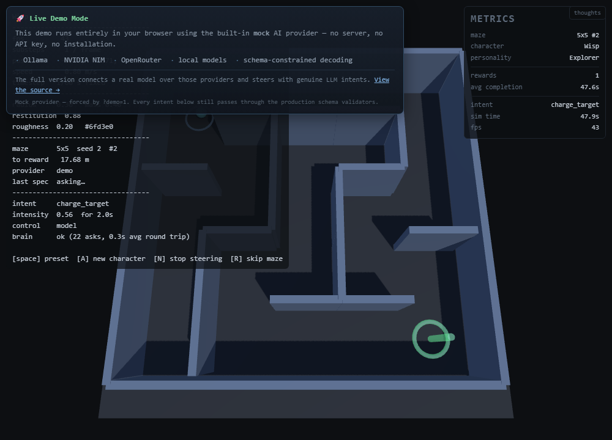
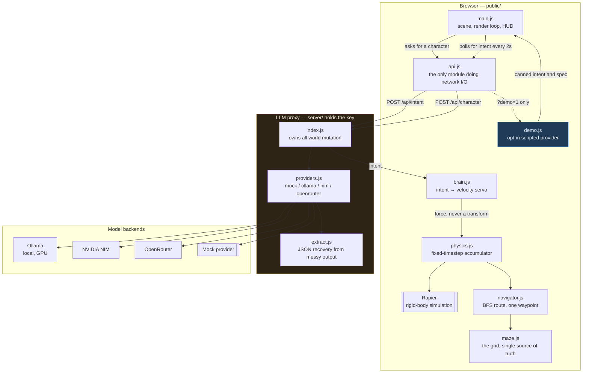

# Bounce

## 🚀 Live Demo

**[Launch the live demo →](https://mheerspink75.github.io/Bounce)**

No install, no API key, no GPU, no backend. It runs entirely in your browser
against a built-in mock provider, so the simulation is the thing you can actually
try. The [full version](docs/deployment.md) connects a real model.

Bounce is an AI-controlled physics simulation where local or cloud-hosted LLMs
create and control autonomous agents navigating procedurally generated mazes.

**Key features**

- **AI-driven character design** — the model invents name, radius, colour, mass,
  bounciness and a one-line personality.
- **LLM steering architecture** — the model emits *intent*, never motion. A
  velocity servo converts intent into forces; the physics engine owns all
  movement.
- **Physics simulation** — Rapier, at a fixed timestep, substepped so the
  simulation keeps real time even when the frame rate does not.
- **Maze navigation** — seeded procedural mazes with deterministic BFS routing.
  The model chooses the goal; the code chooses the route.
- **Local model support** — Ollama and any OpenAI-compatible endpoint, verified
  against `qwen3` on this machine.
- **Schema-constrained outputs** — two-stage sanitising, proxy then client, so a
  model response is trusted no more than the model is.
- **GitHub Pages demo** — the same code, a different provider, deployed static.

[](https://github.com/mheerspink75/Bounce/actions/workflows/tests.yml)
[](https://mheerspink75.github.io/Bounce)
[](LICENSE)
[](docs/testing.md)
[](docs/security-notes.md)

A model invents the character — shape, mass, bounciness, colour, a one-line
personality. A separate loop steers it. The physics engine owns all motion; the
model only ever expresses *intent*.

**The model picks the goal. Deterministic code does the navigating.**


---

## Why This Project Matters

The interesting question is not "can an LLM control a character". It obviously
can. It is: **what happens when the model is slow, small, or wrong?**

Almost every demo of this shape answers by assuming a fast model, hiding the
latency, and never showing a failure. This one makes the failure the subject,
because the failure is the lesson:

- **A model answered `intensity: 5` and the proxy returned HTTP 200.** The schema
  said `maximum: 1`. The provider accepted the request and ignored it. Every
  layer that trusted "the provider returned success" would have put a
  five-times-too-strong character into the simulation.

- **The worst bug in this project's history produced output that was
  *schema-valid* and did nothing at all.** An optional `target` field let a 1.5B
  model emit `null` every time. The grammar then *forbade recovering*. The result
  was six mazes, four minutes, **zero rewards, no error anywhere, and a fully
  green test suite.** Constrained decoding did not just fail to prevent the bug —
  it closed off the paths back out of it.

  The fix was not a prompt change. It was making the field `required`.

- **A 3x faster model is the useless one.** Measured on the same machine,
  `qwen3:1.7b` answers in 0.24s and chooses the goal **0 times out of 5**;
  `qwen3:4b` takes 0.68s and chooses it **5 out of 5**. The 1.7B needed *zero*
  sanitiser intervention — its output was perfectly valid JSON that simply did
  the wrong thing.

- **Seven bugs, and a passing test suite hid most of them.** A reward trigger
  that fired with **4mm** of margin. An assertion named for tunnelling that
  bounded only the outer perimeter — a ball could walk through every internal
  wall and pass it. A "the walls have no collision" report that turned out to be
  four separate bugs, one of which was the character being *invisible*.

The through-line: **a model is untrusted input.** The same posture that stops an
adversarial prompt from teleporting a character through a wall is what stops a
1.5B doing it by accident. Everything else here — the sanitiser, the bounds, the
topological assertions, the two clocks — follows from taking that seriously.

The architecture that results degrades correctly at *any* model speed. Intents
time out, the brain falls back to `wander`, and the character keeps moving.
Because the route is computed locally, one slow intent still walks the character
the whole way — **model latency costs decisions, not motion.**

---

## Status

Working end to end, verified against a real local model driving a real browser.

| | |
| --- | --- |
| **Assertions passing** | **433** — 232 headless, 59 server, 142 browser |
| **Verified model** | `qwen3:4b` on Ollama, native Windows, 100% GPU |
| **Mazes solved unaided** | **3/3** with no manual steering |
| **Intent latency** | **0.68s** warm, inside the brain's 2s poll |
| **Simulation tracks real time** | exact down to **4 fps** |
| **Runs with no API key** | yes — a mock provider, and a zero-backend demo mode |

| Stage | State |
| --- | --- |
| 3D scene, physics, fixed-timestep loop | working, verified |
| Spec-driven character (model → shape, mass, colour) | working |
| Intent-driven control (model → steer the character) | working |
| The model can see and choose the goal | working |
| Maze, reward, and the loop: new maze + goal + character | working |
| Key-holding proxy with origin guard, rate limit, redaction | working, tested |
| Manual intent channel (agent/human steering) | working, **~2s, pre-empts the model** |
| Schema-constrained decoding for small models | working |
| **Local model fast enough to steer with** | **working, GPU** |
| **Zero-backend demo mode for static hosting** | **working, maze solved with no server** |

The automated suite runs on the mock provider, so it is free, offline and
deterministic — and the mock **plays the game**, so the whole loop is
demonstrable with no key at all.

---

## Quick start

```bash
git clone https://github.com/mheerspink75/Bounce.git
cd Bounce/bounce
npm install            # devDependencies only — no runtime dependencies

npm run serve          # static page  -> http://localhost:8080
npm start              # LLM proxy   -> the page calls :8787
```

Open <http://localhost:8080>. On Windows use the project venv for the static
server — `npm run serve` already points at it, because `python` on `PATH` is a
Microsoft Store stub.

| Key | Action |
| --- | --- |
| `Space` | cycle the hardcoded presets |
| `A` | ask the model for a new character (a real model call — slow) |
| `N` | stop the brain steering |
| `R` | skip to the next maze without waiting for the reward |
| `?seed=<n>` | in the URL — pick the maze, so a layout can be shared |

### Demo — no backend required

Open `public/index.html` with `?demo=1`, or host `public/` anywhere static. The
page answers its own three endpoints in-page, so **there is no server, no key and
no model** — and a maze is still solved, because navigation is deterministic.

```bash
npm run test:demo      # proves it: solves a maze with no backend at all
```



Demo mode is **opt-in only**. It never engages automatically when the proxy is
unreachable, because "the proxy is down" and "the model is scripted" have to stay
distinguishable — that distinction is the entire purpose of the HUD's `control`
line.

**Deploying this yourself:** GitHub Pages needs no backend and no configuration —
the page is already the exact tree to publish. A **real-model** deployment needs
a host that runs Node and holds a key; free static hosting cannot do that without
putting the key in browser JavaScript. Both, with the trade-offs:
**[deployment](docs/deployment.md)**.

### With a real local model

```bash
ollama pull qwen3:4b
# bounce/.env:
#   LLM_PROVIDER=ollama
#   LOCAL_BASE_URL=http://127.0.0.1:11435/v1
#   LOCAL_MODEL=qwen3:4b
#   LOCAL_INTENT_MODEL=qwen3:4b

npm run check:ollama   # real browser, real model, prints intents and errors
```

`LLM_PROVIDER=ollama` selects Ollama's **native** `/api/chat`, not the
OpenAI-compat `/v1`. That is the whole point: `think: false` is honoured on one
and **silently ignored** on the other, and getting that backwards looks exactly
like the model being incompatible. Full detail — including why reasoning models
are structurally different rather than merely slower — is in
**[local models](docs/local-models.md)**.

### API key (optional)

```bash
cp bounce/.env.example bounce/.env    # then paste a key
NIM_API_KEY=nvapi-...
curl localhost:8787/api/health
# {"ok":true,"provider":"nim","hasKey":true,"override_active":false}
```

`LLM_PROVIDER` is inferred from whichever key is present — `nim`, `openrouter`,
`local` or `mock`. **The key never reaches the browser.** See
[security notes](docs/security-notes.md).

---

## Is the AI actually driving?

Read the `control` line. It exists because the character moves in every failure
mode too, so **motion proves nothing** — a dead provider, a refused origin and a
working model all produce a ball bouncing around.

```
control    model                                  <- the model chose this intent
control    model (asking…)                        <- in flight
control    manual override (agent/human)          <- a POST to /api/intent/manual
control    off (N pressed) — wandering            <- you stopped it
control    fallback (model said wander)           <- valid answer, nothing to aim at
control    FALLBACK — model not answering         <- not the model; on the built-in wander
```

`brain ok` is **not** sufficient on its own — it describes the *last* request,
and a stale `ok` sits there happily while the current intent is the fallback.
When it is not `model`, the `reason` line says why.

Click **thoughts** to see what the model is emitting next to what got applied:


Worth having for two reasons. The applied intent is *sanitised*, so it looks tidy
whether or not the model behaved — a 1.5B asking for `target: null` and
`intensity: 5` got clamped into something perfectly valid and the character
silently did nothing. And whether the model is *deciding* anything is not
answerable from the applied intent at all: one reward, strongly suggested.

### Steer it yourself

```bash
curl -X POST localhost:8787/api/intent/manual -H 'content-type: application/json' \
  -d '{"action":"charge_target","target":"goal","intensity":1,"ttl_s":180}'

curl -X DELETE localhost:8787/api/intent/manual    # hand control back
```

Takes effect in about **2s**, and it *interrupts* whatever model call is in
flight rather than queueing behind it. That detail is load-bearing — it took the
maze from 28.4s to 8.6s, and 7.9s of that is the walk itself.

---

## Architecture

An LLM call takes **300ms – 2s**. A frame takes **16ms**. An LLM can therefore
never drive per-frame motion, and any design where the model sets velocity each
step is dead on arrival.

So the model is an **intent layer above a deterministic physics engine**, and
`brain.js` converts intent into a **velocity servo** — not a position controller.
That one choice is what makes corners survivable.



The browser never holds a credential. `api.js` is the only module that performs
network I/O, and it can only reach two endpoints.

### Who navigates

The maze is the sharpest version of the problem this project exists to solve.
**The model chooses the goal; deterministic code chooses the route.** One intent —
`charge_target → goal` — walks the character through the entire maze.

The alternative is not a trade-off, it is impossible here: a 37-second-latency
model cannot supervise a turn, and a 1.5B cannot hold a maze in its head. Putting
reasoning in the model would also mean the character only works when the model is
fast and clever, which is exactly the coupling this architecture exists to avoid.

So navigation is local, boring, and **testable in a way the rest of the system
cannot be**: 12 seeds × 4 character sizes, all solved, no model involved.

`maze.js` is the single source of truth — collision geometry and the navigation
graph are *both* derived from the grid. Defining the maze twice is the obvious way
to build this and the wrong one: the two disagree the first time a wall moves, and
the failure is a character that confidently walks into a wall.

### Bounds that keep a bad model from breaking the simulation

A model is untrusted input. Every response is sanitised **three times** — proxy,
client, brain:

| Field | Bound | Why |
| --- | --- | --- |
| `restitution` | 0 – **0.95** | at 1.0 the solver injects energy and the character accelerates for ever |
| `intensity` | 0 – 1 | multiplies an acceleration ceiling; above 1 is how a model talks a character through a wall |
| `radius` | 0.15 – 2.0 | larger still fits the arena |
| `duration_s` | 0.5 – 10s | stops one intent dominating |

Plus a **speed ceiling** (10 m/s, and 3.5 m/s while navigating — corners are the
binding constraint, not tunnelling) and a substep cap. A hostile-intent test —
`intensity: 999`, `duration_s: 1e9`, a rotating cast of actions, 60 seconds —
stays inside the arena and under the ceiling.

Full detail, with the four diagrams and the request flow:
**[architecture](docs/architecture.md)**.

### The contracts

**Character spec** — model to client. All fields untrusted:

```json
{ "name": "Bounce-7", "radius": 0.6, "color": "#e05a3f",
  "mass": 1.2, "restitution": 0.85, "roughness": 0.35,
  "personality": "reckless, favours chaos over efficiency" }
```

Numeric strings are accepted (`"0.6"` → `0.6`); empty strings are rejected
explicitly, because `Number('')` is `0`. Colours must be 3- or 6-digit hex.
`NaN` and `±Infinity` fall back per-field.

**Intent** — model to client:

```json
{ "action": "seek" | "wander" | "charge_target" | "rest",
  "target": "block_a" | "block_b" | "ramp" | "goal",
  "intensity": 0.6, "duration_s": 3.0 }
```

`action` is a **closed enum**; anything else becomes `wander`. The arena target
ids come from `public/targets.js` — the same file the physics world builds its
obstacles from. `goal` is added by the *page*, which knows whether a maze exists.
Unknown ids degrade to a wander.

`target` stays a free string in the schema, deliberately — the ids live in the
world, not the schema, and a stale enum fails worse than a loose one. But it **is**
`required`, and that is a separate decision with a measured reason: an optional
target is an escape hatch that small models take every time, and a null target
silently means the character does nothing. See
[debugging lessons](docs/debugging-lessons.md).

---

## Results

### Benchmarks

Measured with `npm run bench:local`, which benchmarks **through the real proxy**
so JSON extraction and sanitising are inside the measurement.

| Model | Intent latency | Character design | Goal selection | **Success rate** |
| --- | --- | --- | --- | --- |
| `qwen3:1.7b` | **0.24s** | 2.9s | **0 / 5** | **0%** |
| `qwen3:4b` | 0.68s | 49.1s *(thinking on)* | **5 / 5** | **100%** |

**The faster model is the useless one.** The 1.7B needed *zero* sanitiser
intervention — its output was valid JSON that did the wrong thing. That is the
central lesson of this repository, reproduced with fresh data on a different GPU.

Full model comparison, including historical hardware and why reasoning models are
a different shape rather than a slower one:
**[local models](docs/local-models.md)**.

### The loop, unaided

A real local model, no manual steering at all:

```
t=  65.05  REWARD  maze 5x5, path 13 cells
t=  65.05  ADVANCE seed 2 5x5
t= 203.27  NEW CHARACTER  Sparkle r=0.25
t= 208.73  REWARD  maze 5x5, path 11 cells
t= 208.73  ADVANCE seed 3 5x5
t= 297.77  NEW CHARACTER  Sproing r=0.25
t= 308.02  REWARD  maze 5x5, path 9 cells
```

Note the character taking ~140s to arrive after each advance. That is not lag —
the maze advances instantly and the character catches up when the model answers,
because a design is a 49-second model call and nobody should watch a finished
board for most of a minute.

### Tests

```bash
npm test               # 232 headless + 59 server. No browser, no network, no key.
npm run test:maze      # 55 of those: generation, routing, and the reward loop
npm run test:timestep  # 16 of those: the simulation keeps real time at low fps
npm run test:browser   # 142 browser + WebGL assertions (needs both servers up)
npm run test:loop      # drives 2 full mazes unaided in the real page
npm run test:demo      # static-only: solves a maze with no backend and no model
npm run check:ollama   # real model, real browser (needs Ollama running)
npm run bench:local    # model comparison through the real proxy
```

`npm test` needs only Node — which is what CI runs. Details on the diagnostic
scripts and the testing philosophy are in **[testing](docs/testing.md)**.

---

## Known limitations

**Model quality, not model latency, is the binding constraint.** Latency is
solved: 0.68s per intent is inside the brain's 2s poll. What remains is that the
model *follows* the goal instruction rather than *deciding* — one reward,
strongly suggested, is not a choice. That is item 1 on the
[roadmap](docs/roadmap.md).

The architecture degrades correctly at any speed, so this is a ceiling rather than
a failure: intents time out, the brain falls back to `wander`, and the character
keeps moving.

Smaller known issues:

- **Ollama ignores JSON-schema numeric bounds.** HTTP 200, then out-of-range
  numbers. The sanitiser catches them. The schema buys the *shape* and the
  *enum* reliably; the ranges are the sanitiser's job.
- **Headless Chromium renders in software** (SwiftShader). Headed mode gets the
  real GPU. Anything measuring rendering has to say which mode it ran in.
- **`npm run test:browser` skips with exit 0** if Chromium's libraries are
  missing, so a green run can mean 142 assertions never executed.
- **The HUD overlaps the left third of the maze.** Readable; a
  `camera.setViewOffset` would compose properly.
- The OpenRouter adapter shares the NIM code path but is **unexercised**.

---

## Documentation

| | |
| --- | --- |
| **[Architecture](docs/architecture.md)** | how it fits together, with four Mermaid diagrams: system graph, request flow, decision pipeline, character lifecycle |
| **[Local models](docs/local-models.md)** | running offline, environment, and the full model comparison |
| **[Testing](docs/testing.md)** | all suites, the diagnostic scripts, and the testing philosophy |
| **[Debugging lessons](docs/debugging-lessons.md)** | the seven bugs, and why a green suite hid them |
| **[Performance](docs/performance-analysis.md)** | where the time actually goes, measured |
| **[Security](docs/security-notes.md)** | the key-holding proxy, origin guard, redaction, publishing checklist |
| **[Gotchas](docs/gotchas.md)** | every hard-won lesson, grouped |
| **[Deployment](docs/deployment.md)** | GitHub Pages, Vercel, Netlify — and why free hosting cannot hold a key |
| **[Roadmap](docs/roadmap.md)** | what is next, in priority order |

---

## Scope

**In:** one character in a browser; a model designs it and steers it; a maze with
a goal the model is told about and can choose; the full loop; a manual steering
channel; everything free and open source with no API key required to run.

**Out:** real humanoids and rigging, neural image-to-3D, mocap libraries,
multiplayer, and Unity or Unreal of any kind.

**The path to real characters** is the spec contract. When the ball becomes a
humanoid, the same JSON object points at MPFB2/CharMorph parameters or a glTF URL
instead of `THREE.SphereGeometry`. Build the contract first, swap the generator
later — which is why it is schema-constrained from the start.

---

## Contributing

Run `npm test` **and** `npm run test:browser` before calling anything done. A
syntax check is not a substitute: a temporal-dead-zone bug shipped once because
`node --check` passed and only the browser test caught it.

When adding behaviour, put it in `brain.js` as a *deterministic* action. The model
picks which action; the code decides what it does. That split is what keeps the
thing debuggable — and the maze is the proof: all the hard problems were in
deterministic code, and none of them needed the model.

**Measure before you fix, and log before you guess.**

## Licence

MIT — see [LICENSE](LICENSE).

Built with [three.js](https://threejs.org/) and
[Rapier](https://rapier.rs/) (both devDependencies — there are no runtime
dependencies).