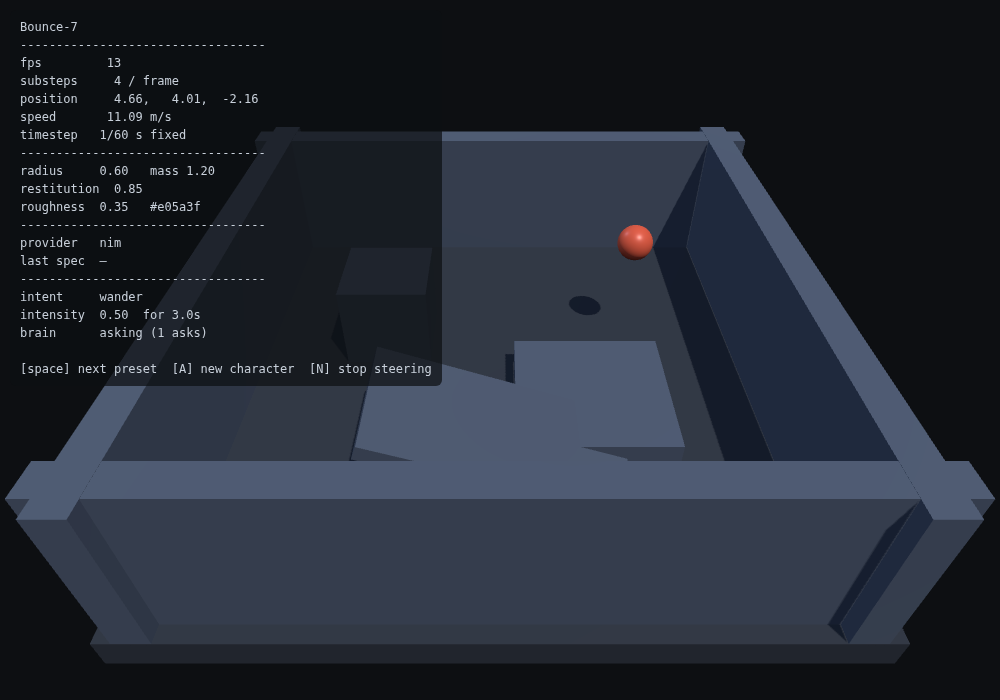
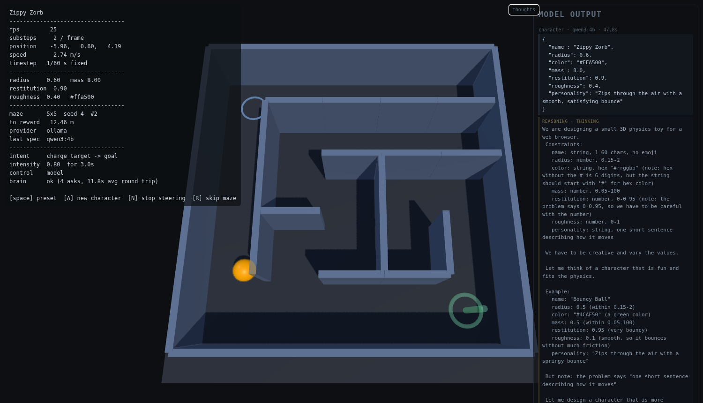

# Character Design

An AI-designed, AI-controlled 3D character in a web browser.

A model invents the character, then a separate loop steers it. The physics
engine owns all motion; the model only ever expresses *intent*.

The character has a job: cross a procedurally generated maze, collect the reward
at the far corner, and do it again — new maze, new goal, new character, forever.
**The model picks the goal; deterministic code does the navigating** — see
[Who navigates](#who-navigates).



---

## Status

**Working end to end**, verified against a real model (NVIDIA NIM) and a real
local model (llama.cpp).

| Stage | State |
| --- | --- |
| 3D scene, physics, fixed-timestep loop | working, verified |
| Spec-driven character (model → shape, mass, colour) | working |
| Intent-driven control (model → steer the character) | working |
| The model can see and choose the goal | working |
| Maze, reward, and the loop: new maze + goal + character | working, **4 mazes unaided** |
| Key-holding proxy with origin guard, rate limit, redaction | working, tested |
| Manual intent channel (agent/human steering) | working, **~2s, pre-empts the model** |
| Schema-constrained decoding for small models | working, 8/8 runs |
| Simulation keeps real time down to 4 fps | working, measured |
| **Local model fast enough to steer with** | **working, 0.55s per intent, GPU** |
| **1.5B on CPU alone drives the loop** | **working, 5 mazes, no GPU** |

**433 assertions pass**: 232 headless, 59 server, 142 browser. The automated suite
runs on the mock provider, so it is free, offline and deterministic — and the
mock **plays the game**, so the whole loop is demonstrable with no key at all.

**The old latency blocker is gone, and so is the small-model blocker.** A local
`qwen2.5:7b-instruct` on the GTX 1080 Ti answers an intent in **~0.55s** and a
character spec in **~1.8s**, so the brain's 2s poll is no longer the slowest
thing in the loop. A **1.5B on CPU alone** — no GPU anywhere, browser rendering
in software on the same cores — drives **5 mazes unaided** at ~1.2s per intent.
That combination was measured at **0 mazes in 4 minutes** until the intent schema
was fixed; see [Schema-constrained decoding](#schema-constrained-decoding) for
why an *optional* field was the whole problem.


---

## Running it

Two processes, two ports:

```bash
cd bounce
npm install        # devDependencies only — no runtime dependencies
npm run serve &    # static page   -> http://localhost:8080
npm start &        # proxy / API   -> http://localhost:8080 talks to :8787
```

> **On this box, `npm` is the Windows one** and cannot run these scripts — see
> [Environment](#environment). Use the equivalent directly:
>
> ```bash
> node --env-file-if-exists=.env server/index.js &        # proxy, :8787
> python3 -m http.server 8080 --directory public &       # static, :8080
> ```

Open <http://localhost:8080>.

| Key | Action |
| --- | --- |
| `Space` | cycle the hardcoded presets |
| `A` | ask the model for a new character (a real API call — slow) |
| `N` | stop the brain steering |
| `R` | skip to the next maze without waiting for the reward |

Click **thoughts** (top right) to see what the model is actually emitting, next to
what got applied:



It is worth having for two reasons, both learned the hard way. The applied intent
is *sanitised*, so it looks tidy whether or not the model behaved — a 1.5B asking
for `target: null` and `intensity: 5` got clamped into something perfectly valid
and the character silently did nothing, six mazes and zero rewards with no error
anywhere. And whether the model is *deciding* anything is not answerable from the
applied intent: one reward, strongly suggested, and the 7B answers
`charge_target -> goal` every time because the prompt tells it to.

The **REASONING** block is the model's own scratch work, and it only appears for
models that publish it. That is a different set from the models that are fast
enough to steer with:

| Model | Steering | Character design | Reasoning shown |
| --- | --- | --- | --- |
| **`qwen3:4b` (current)** | **0.65s** | 33–63s | **yes**, on design only |
| `qwen2.5:7b-instruct` | 0.55s | 1.8s | no — it does not think out loud |
| `gpt-oss:20b` | 15.9s (3m35s cold) | 16s | yes |
| `deepseek-r1:1.5b` / `:7b` | never answers | — | always thinks; no off switch |

**One model, two modes.** `qwen3` is a *hybrid* model: it can be told to think or
not to, which is the only reason this works. Thinking is **off** for intents
(0.65s, no scratch work) and **on** for character design, where it is affordable.
Same weights, same process, no second download. At 2.5GB it fits the 1080 Ti's
VRAM outright — unlike `gpt-oss:20b` at 13GB, which had to be split across GPU and
system RAM and paged in on every request.

That last row is the one that matters, and reaching it went wrong first.
**`think: false` is honoured on Ollama's native `/api/chat` and silently ignored on
its OpenAI-compat `/v1` endpoint.** Same model, same request:

| Endpoint | `think: false` | Result |
| --- | --- | --- |
| `/v1/chat/completions` | ignored | 507 chars of reasoning, `content: ''` |
| `/api/chat` | honoured | 0 chars, **0.63s**, `done=stop` |

The `/v1` result is byte-for-byte the symptom I used to conclude that
`deepseek-r1` was "structurally incompatible with this project". It was not. The
model was fine, the URL was wrong, and a whole recommendation was built on the
misreading. `LLM_PROVIDER=ollama` exists specifically to select the native
endpoint; `local` is the OpenAI-compat one and will silently spend the entire
intent budget on scratch work.

**R1 is still unusable, and now for the right reason.** It has no off switch —
484 characters of scratch work through `/api/chat` with `think: false` anyway. A
model that can be told not to think fits a 120-token budget; one that cannot does
not, at any budget this project can afford. `deepseek-r1:7b` fails identically at
4.7GB where 1.5b needs 1.1GB: a smaller reasoning model is not a cheaper one, only
a faster wrong one.

**DeepSeek-R1 is structurally incompatible with this project's intent path**, and
it is worth recording why, because "it's a reasoning model, it'll show reasoning"
is exactly the wrong inference. Measured on `deepseek-r1:1.5b`:

| max_tokens | finish_reason | `content` |
| --- | --- | --- |
| 120 (the intent budget) | `length` | **`''`** |
| 400 | `length` | `''` |
| 800 | `stop` | 428 tokens, and the JSON is wrong anyway |

R1 emits its reasoning **first** and the answer last, out of the *same* token
budget. The provider caps intents at 120 tokens because an intent is a small
object — so R1 spends all 120 thinking and never writes the answer. The proxy
correctly refuses to invent one:

```
{"error":"local: response contained no content"}   HTTP 502
```

Three separate things had to be true for this to work, and only the first does:

1. **A much larger budget.** ~430 tokens per intent, not 120. That is not a
   constant to change — it is the *reason* for the 120.
2. **Schema-constrained decoding would still not help.** It is what makes a ≤2B
   model viable here at all, and against R1 it changes nothing: the constraint
   governs the answer while the reasoning consumes the budget that would have
   produced it. Verified with the real `INTENT_SCHEMA` attached — `finish_reason:
   length`, `content: ''`, 526 characters of scratch work.
3. **R1 cannot be told to stop thinking.** Ollama's `think: false` is ignored on
   both endpoints: 508 characters of reasoning through `/v1`, 484 through
   `/api/chat`. There is no switch, and a distilled `DeepSeek-R1-Distill-Qwen-1.5B`
   is the same architecture with the same habit.

And once it *does* answer, the answer is unusable. Asked for four fields, R1
produced `{"priority": 8, "action": "get奖励", "target": reward, "intensity": 9,
"duration": 15}` — an invented key, a mixed-language action outside the closed
enum, an unquoted target, and `duration` instead of `duration_s`. The sanitiser
degrades all of it to a wander, and `extractJsonObject` returns `null` on the
unquoted value, so the request 502s.

The general point: **a reasoning model is not a faster or cleverer non-reasoning
one, it is a differently-shaped one.** This project's intent contract assumes the
first token of the response is the answer, because that is what makes a 120-token
budget possible. R1 breaks that assumption, and no amount of prompt or schema work
restores it — the scratch work comes first and has to be paid for in full.

`deepseek-r1:7b` fails identically and costs roughly five times as much to do it:
same architecture, same habit, and 4.7GB of weights where 1.5b needs 1.1GB. It
was pulled and is available; there is no configuration of this project it works
under. Size is the *least* of the problems — a smaller reasoning model is not a
cheaper reasoning model, only a faster wrong one.

**What this costs the loop, in one number.** `scripts/loop-check.mjs` had a
4-minute deadline, which the 7B cleared comfortably and `gpt-oss:20b` did not — it
failed with 0 mazes while the model was answering correctly at 3.7s a call. The
deadline is now `LOOP_DEADLINE_MS` (default unchanged at 240s), and with a 15-minute
budget gpt-oss completes 2 mazes unaided at t=77.7s and t=149.1s. A harness that
reports "the model cannot drive" when the model *is* driving, three seconds per
decision, is indistinguishable from a real failure — the same lesson as the reward
trigger that passed by 4mm.

**The cost is hardware, and it is worth being precise about why.**
`gpt-oss:20b` is 13 GB of weights; the 1080 Ti has about 10 GB free, so the model
is split across VRAM and system RAM and the weights must be paged in on every
request after `keep_alive` expires. A first call took **3m35s**, of which 174s was
loading the weights alone; once resident it settles to **15.9s** per intent. Both
are far outside this project's design point — the brain polls every 2s, so an
intent that arrives in 16s is a control loop running at a sixteenth of its
intended rate.

**The panel makes the trade visible, which is the point of it.** In the screenshot
above, the HUD reads `control FALLBACK — model not answering` and
`brain asking (4 asks, 11.5s avg round trip)` *while the panel shows a complete,
correct decision* — the model had answered and the character was acting on an older
intent. Those two views disagree, and only the pair of them is honest.

There is no standard field for scratch work, and reading the wrong one is the
failure mode that matters: a reasoning model then appears to emit prose instead of
JSON. Measured against Ollama serving gpt-oss:20b, the field is `reasoning`;
`reasoning_content` is DeepSeek's spelling and `thinking` is Ollama's native API.
The adapter reads all three, from the message *and* from the choice, and reports
which one answered as `reasoning_field` — so an empty panel is distinguishable
from a provider whose scratch work is being looked for in the wrong place.

The panel logs an entry when the decision *changes*, when the sanitiser had to
intervene, or when a character is designed — not on every one of the 2s polls,
which would fill it in half a minute. Model output is inserted as text, never as
markup, and goes through the same key-shaped-string redaction as every other
response body; a model is free to emit `<script>` and this is the one place that
text is shown to a human.

### Is the AI actually driving?

Read the `control` line. It exists because the character moves in every failure
mode too, so **motion proves nothing** — a dead provider, a refused origin and a
working model all produce a ball bouncing around:

```
control    model                                  <- the model chose this intent
control    model (asking…)                        <- in flight
control    manual override (agent/human)          <- a POST to /api/intent/manual
control    off (N pressed) — wandering            <- you stopped it
control    fallback (model said wander)           <- valid answer, nothing to aim at
control    FALLBACK — model not answering         <- not the model; on the built-in wander
```

`brain ok` is **not** sufficient on its own — the status is about the last
request, and a stale `ok` sits there happily while the current intent is the
fallback. When it is not `model`, the `reason` line says why:

```
reason     proxy unreachable from page origin http://127.0.0.1:8080 — usually this
           origin is not in the proxy's ALLOWED_ORIGIN (proxy http://127.0.0.1:8787)
```

`last spec` answers a different question — it is the *character* design, shown
only after you press `A`, so `—` is normal on a fresh page and says nothing about
steering.

`?seed=<n>` in the URL picks the maze, so a layout can be shared or reproduced. It
is rewritten as the loop advances, so copying the URL mid-run captures the maze
you are actually on.

### Steer it yourself (fast)

```bash
# send it to the reward — the maze is solved deterministically, so this
# arrives in ~8s even though the model round trip is tens of seconds
curl -X POST localhost:8787/api/intent/manual -H 'content-type: application/json' \
  -d '{"action":"charge_target","target":"goal","intensity":1,"ttl_s":180}'

curl -X DELETE localhost:8787/api/intent/manual     # hand control back
```

The page takes effect in about **2s**, and it *interrupts* whatever model call is
in flight rather than queueing behind it. That detail is load-bearing — see
[Steering has to pre-empt](#steering-has-to-pre-empt-the-model).

### API key

Create `bounce/.env` from the template — see `bounce/.env.example`.

```bash
cp .env.example .env      # then paste your key
NIM_API_KEY=nvapi-...
```

`LLM_PROVIDER` is optional; it is inferred from whichever key is present
(`nim`, `openrouter`, `local`, or `mock`). `npm start` loads `.env` via Node's
built-in `--env-file-if-exists` — **no `dotenv` dependency**. The key never
reaches the browser. Verify:

```bash
curl localhost:8787/api/health
# {"ok":true,"provider":"nim","hasKey":true,"override_active":false}
```

### Tests

```bash
npm test               # 232 headless + 59 server. No browser, no network, no key.
npm run test:maze      # 55 of those: maze generation, routing, and the reward loop
npm run test:timestep  # 16 of those: the simulation keeps real time at low fps
npm run test:browser   # 142 browser + WebGL assertions (needs both servers up)
npm run test:loop      # drives 2 full mazes unaided in the real page (needs both)
```

`npm test` needs only Node. `test:browser` skips cleanly if Playwright is absent.

Diagnostic scripts, for when a number looks wrong:

```bash
node scripts/maze-timing.mjs        # seconds to the reward, no rendering
node scripts/substep-budget.mjs     # what a physics substep actually costs
node scripts/diagnose-maze.mjs 5    # ASCII map + what the navigator aimed at, seed 5
node scripts/maze-browser-check.mjs # drives the real page, prints the event timeline
node scripts/loop-check.mjs 4       # the whole loop, 4 mazes, unaided
node scripts/goal-prompt-check.mjs  # does a real model pick the goal? (needs a live provider)
node scripts/wall-penetration.mjs 8 grow   # is the character ever inside a wall?
```

`wall-penetration` answers the question the perimeter assertion could not: it
measures 3D overlap per frame *and* watches for the character reaching a cell it
could not have walked to. `grow` resizes the character mid-run the way the loop
does, which is the case most likely to embed it in geometry.

`loop-check` is the one that answers "is the whole thing actually working" — it
sends **no** manual intent and just watches the model play. `maze-browser-check`
is the most useful when a number looks wrong: it reports simulated time against
wall clock and prints every intent change, character swap and reward, which
separates "the simulation is slow" from "the character is misbehaving" — two
problems that look identical in a screenshot.

---

## Scope

### In scope

- One character in a browser — a ball navigating a maze to a reward
- A model designs it (shape, mass, bounciness, colour, a one-line personality)
- A model steers it, at low frequency, through a fixed set of intents
- A maze with a goal the model is told about and can choose
- A loop: reward collected → new maze, new goal, new character
- A manual channel so a human or agent can steer it directly
- Everything free and open source, with no API key required to run

### Out of scope

- Real humanoids, rigging, skinning, retargeting
- Neural image-to-3D, 3D asset optimisation, LOD work
- Mixamo or any mocap library (not open source)
- Multiplayer, server-authoritative physics
- Unity or Unreal of any kind

### The path to real characters

The spec contract is the load-bearing part. When the ball becomes a humanoid, the
same JSON object points at MPFB2/CharMorph parameters or a glTF URL instead of
`THREE.SphereGeometry`. **Build the contract first, swap the generator later** —
that is why it is schema-constrained from the start.

---

## Architecture

### The constraint that dictates everything

An LLM call takes **300ms – 2s** at best. A frame takes **16ms**. An LLM can
therefore never drive per-frame motion. Any design where the model sets the
character's velocity each step is dead on arrival.

The model is an **intent layer above a deterministic physics engine**:

```
LLM  (slow)  →  intent: "seek the ramp", "wander", "rest"
Physics (fast) owns all motion, collisions and forces
```

`brain.js` turns intent into a force. Rapier owns everything else. It never sets
a velocity or a position.

**Two clocks, deliberately:**
- intents are held for `duration_s` of *simulation* time, so a backgrounded tab
  does not change the character's mind;
- requests are paced from *wall-clock completion*, so a slow provider makes the
  brain ask less often instead of stacking up requests.

### Bounds that keep a bad model from breaking the simulation

A model is untrusted input. Every response is sanitised three times — proxy,
client, brain — and the bounds are what make a bad answer harmless:

| Field | Bound | Why |
| --- | --- | --- |
| `restitution` | 0 – **0.95** | at 1.0 the solver injects energy and the character accelerates forever |
| `intensity` | 0 – 1 | multiplies an acceleration ceiling; above 1 is how a model talks a character through a wall |
| `radius` | 0.15 – 2.0 | larger still fits the arena |
| `duration_s` | 0.5 – 10s | stops a single intent dominating |

Plus a **speed ceiling** (10 m/s, and 3.5 m/s while navigating — corners are the
binding constraint, not tunnelling) and a **substep cap** in the fixed-timestep
loop. A hostile-intent test — intensity `999`, duration `1e9`, a rotating cast of
actions, 60 seconds — stays inside the arena and under the ceiling.

### Who navigates

The maze is the sharpest version of the problem this project exists to solve, so
it is worth being explicit about the split.

**The model chooses the goal. Deterministic code chooses the route.** One intent,
`charge_target → goal`, and the character walks the entire maze on that one
decision.

The alternative — asking the model for "go left, now go right" — is not a
trade-off, it is impossible here. A 37-second-latency model cannot supervise a
turn, and a 1.5B model cannot hold a maze in its head. Putting reasoning in the
model would also mean the character only works when the model is fast and clever,
which is exactly the coupling this architecture exists to avoid.

So navigation is local and boring, and it is **testable in a way the rest of the
system cannot be**: 12 seeds × 4 character sizes, all solved, no model involved.

Three pieces, each with one job:

- **`maze.js`** — a grid, carved by recursive backtracker from a seed. The grid is
  the *only* source of truth; collision geometry and the navigation graph are both
  derived from it. Defining the maze twice is the obvious way to build this and
  the wrong one — the two disagree the first time a wall moves, and the failure
  is a character that confidently walks into a wall.
- **`navigator.js`** — BFS for the route, then one waypoint at a time.
- **`brain.js`** — a velocity servo, not a position controller. This is what makes
  corners survivable; see [Two bugs worth remembering](#two-bugs-worth-remembering).

The maze is **sized from the character radius**, which is the one thing that has to
fit through a corridor. The model picks `radius` freely, so a fixed corridor would
strand a fat character; instead grid dimensions are derived from the radius and
clamped to 3×3–9×9, so a `radius: 2.0` character gets a coarser (but still real)
maze rather than one it cannot enter. This coupling is visible in the loop: when
the model designs a fatter character, the next maze is genuinely smaller.

### The model needs to be told what the goal is

`goal` is a target like any other — the brain resolves it, the navigator walks to
it — but the **server cannot know it exists**, because whether there is a maze at
all is a fact about the page. So the page reports its world with every intent
request:

```jsonc
// POST /api/intent
{ "targets": ["block_a", "block_b", "ramp", "goal"],
  "goal": { "id": "goal", "distance_m": 17.9, "path_cells": 9,
            "maze": "5x5", "reached": false } }
```

and the prompt is built from that, not frozen at module load. A frozen prompt is
how a model ends up steering toward something that is not there, or ignoring
something that is.

**The target stays a free string in the JSON Schema, deliberately.** It was
tempting to add an enum of ids, and that would have been the wrong fix: the ids
live in the world, not in the schema, and a stale enum fails worse than a loose
one. The blocker was only ever the prompt and the reported list.

The report is treated as untrusted, like everything else — the proxy sanitises
model output three times over, so accepting a page's claims unchecked would be a
strange exception. Ids are pattern-checked and capped, and **nonsense numbers are
rejected rather than clamped**: a negative `path_cells` clamped to 0 would tell
the model "you are at the goal", and a confident lie is worse than an admitted
unknown.

### The loop

A collected reward ends the run and the next one starts immediately: new seed,
new maze, new goal, new character.

The maze and the character are handled separately on purpose. A new maze is free
and instant; a new character is a model call worth 14–58s on the free tier.
Awaiting it before starting the next maze would mean watching a finished board
for most of a minute, so the maze advances at once and the character catches up
when the model answers — the same "a redesign is not a restart" rule the manual
swaps follow.

The brain is also `poke()`d on the advance, because the goal it was told about no
longer exists; without that it steers at the old goal's coordinates until the
intent lapsed.

Verified unaided, with no manual steering at all:

```
t=  17.05  REWARD  maze 5x5, path 13 cells
t=  17.05  ADVANCE seed 2 5x5
t=  17.25  NEW CHARACTER  Brace{y} r=0.4
t=  28.43  REWARD  maze 5x5, path 11 cells
t=  28.43  ADVANCE seed 3 5x5
t=  28.63  NEW CHARACTER  Ember r=0.9
t=  37.97  REWARD  maze 4x4, path 7 cells      <- fatter character, coarser maze
t=  37.97  ADVANCE seed 4 4x4
```

### The simulation must keep up with the wall clock

A substep cap exists so a stall cannot trigger a death spiral of steps. It is
also the easiest way to make a demo lie: if the cap is too tight, the simulation
quietly runs slower than real time, and **every timing the project reports becomes
wrong while every test still passes** — the tests assert outcomes, not rates.

So measure before choosing a number. `scripts/substep-budget.mjs`:

```
20000 single-substep advances took 697.0ms
  -> 0.03485 ms per 1/60s substep
cap 5 -> 0.17ms/frame   (0.2% of a 66-83ms frame)
cap 15 -> 0.52ms/frame  (0.6%)
```

Physics is **0.2% of the frame** on a software renderer. The old cap of 5 meant
the simulation went slow below 12 fps — which is exactly where this box sits.
Worse, `MAX_SUBSTEPS × FIXED_TIMESTEP` was 0.083s while `MAX_FRAME_DT` was 0.25s,
so the two halves of the same safety mechanism disagreed by 3× and the frame
clamp was dead code. The cap is now **derived** from `MAX_FRAME_DT`, so they
cannot drift apart again, and real time holds down to 4 fps for 0.5ms a frame.

`test/timestep.test.mjs` then pins the behaviour: 100% of real time at every rate
from 60 to 4 fps, no drift over 5 simulated minutes, and a 5-second stall still
clamped to 0.25s.

### Steering has to pre-empt the model

The manual channel is advertised as the responsive path, and it was not. Two
separate bugs, both invisible with a fast provider:

**1. The override's TTL was decorative.** An intent is held for `duration_s`, then
the brain falls back to `wander` until the next poll. A manual intent sent with
`ttl_s: 180` but a default `duration_s` of 3 was therefore obeyed for about half
of its life. The server now reports a `duration_s` spanning the remaining TTL
(capped at the schema's 10s), so the override is held continuously.

**2. A manual intent could not interrupt an in-flight model call.** The brain
paces requests *from completion*, which is correct — it stops a slow provider
stacking requests — but it also means that during a 20s call the brain asks for
nothing at all. A manual intent posted in that window sat in a queue until the
call timed out.

Measured on seed 1 with the live NIM provider, the maze took **30.5s of simulated
time**, and the timeline said why:

```
t= 0.00  intent  wander
t=22.05  intent  charge_target -> goal
t=30.92  REWARD
```

22 of 30 seconds dead, waiting on a request nobody wanted. The fix is
`brain.interrupt()` plus a 200ms poll of `/api/health` — already cheap, already
carrying `override_active`, no credentials — so a new override aborts the
outstanding call and re-asks at once. Same run afterwards:

```
t= 0.00  intent  wander
t= 1.90  OVERRIDE  manual override appeared
t= 2.25  intent  charge_target -> goal
t=11.15  REWARD
```

**28.4s → 8.6s**, and 7.9s of that is the walk itself, which matches the 8.1s
headless figure. Override-to-intent is 0.35s.

Note the first guess here was wrong. The symptom — "much slower with NIM than
with the mock provider" — looked exactly like the character spec landing mid-run
and resetting progress, and a plausible fix for that was written first. The
timeline showed `applySpec` had never been called. Both bugs were still real and
are still fixed and tested; neither was the cause of this number.

### A redesign is not a restart

`replaceCharacter` had two bugs, both invisible with a fast provider:

- The replacement spawned at the **maze start**, so every new character discarded
  the run in progress. Harmless-looking when a spec arrives instantly; with NIM
  taking 14–58s it lands mid-walk. The character now appears where the old one
  was, just above it so nothing intersects.
- The maze was sized for the **original** radius. The model picks `radius`
  freely, so a `radius: 2.0` character (4m across, in 2.4m corridors) would wedge
  in the first corridor forever, with no error and no way out. The maze is now
  rebuilt when a new radius needs a different grid — and when it is, the run
  genuinely is lost, which the HUD says rather than leaving you to guess.

### Seven bugs worth remembering

Both were found by the maze, and both are the kind that a passing test suite hides.

**1. `findPath` ignored the walls.** It checked only whether the *destination cell*
was open — correct for the first representation, where walls were whole cells, and
silently wrong after the switch to walls on cell boundaries, where every cell is
open. BFS then routed straight through them, and the character followed a perfectly
plausible route into a wall. The existing assertion — "every cell on the path is
open" — was *trivially true* and would never have caught it. The assertion that
matters is **"the path never crosses a wall"**.

**2. A position controller cannot brake.** Steering with force-toward-a-point means
that when the aim swings 90° at a corner, the character keeps its old momentum,
overshoots, hits the far wall and bounces back. Measured: a character reached the
end of the first corridor in 1s, then spent **59 seconds** oscillating between two
cells. Lowering the speed cap did not help. Replacing it with a velocity servo —
steer toward a *desired velocity*, so the servo actively brakes as the target
direction changes — fixed it.

The general lesson: the first three attempted fixes (cached routes with
invalidation, a lower speed cap, a wall-clearance margin) all made things *worse*,
and each was a guess. What found both bugs was bisecting the system — a pure-logic
test of the navigator with no physics at all, which proved routing was correct
before any of the control questions were even asked.

**3. The character could leave the maze without touching a wall.** Reported as
"the walls have no collision". They do — they always have. The character was
being *dropped in from above them*.

`toWorld()` returns `{x, z}`; it cannot know the character's radius. `createWorld`
built its maze spawn by spreading that, so the spawn object had **no `y` at
all**, and `createCharacter` fell through to its open-arena default of
`SPAWN_Y = 7`. The maze walls span y = −1.2 … 3.6, so every run began 3.4m above
the top of every wall and fell in. A hard enough landing sent it over them, and
the ball would turn up in corridors it could not have walked to — which is
indistinguishable, from a screenshot, from having no colliders.

A second bug was hiding behind the first. `spawnAt` was captured once at startup,
so every later maze inherited the *first* maze's start cell, and — worse — the
*first* radius as its height. Growing the character therefore spawned the new,
fatter body with a stale `y`: a radius-2.0 ball at y=0.6 has its underside 1.4m
inside the floor, and Rapier's answer to that is to eject it. Measured 0.37m of
overlap — clean through a 0.35m wall. This one fires in normal operation, because
the loop resizes the character every generation.

Both are fixed: the spawn is a function of the current layout *and* radius, and a
replacement that would not fit where the old one stood now snaps to the cell
centre, which `gridSizeFor` guarantees is wide enough.

**The assertion that should have caught it did not.** `navigation.test.mjs` had

```js
check('never tunnels through a maze wall', worst < 8.5, ...)
```

where `worst` is `max(|x|, |z|)`. That bounds the maze's *outer perimeter*. A ball
that walks through every internal wall and lands in the far corner satisfies it
completely. The assertion was named for the one property it did not test — a
worthless assertion by this project's own definition, sitting in the file whose
entire job is proving the maze works. It is renamed to what it actually bounds,
and `test/wall-containment.test.mjs` now asserts the real thing.

That test also settles a distinction worth keeping: **overlap is not
pass-through.** A loaded contact always leaves some penetration, and a 2.0-radius
ball shoved into a corner overlaps by ~4cm while its centre is still 1.96m
*outside* the wall face. Asserting on overlap alone cannot tell "pressed into a
wall" from "went through it", and tuning the tolerance until it went green would
have hidden the bug rather than fixed it. So the load-bearing assertion is
topological: track which cell the character is in, and require that every change
is between cells `maze.connected()` says are adjacent. That has no tolerance and
cannot be fudged. Measured over 100s × 6 seeds with the character resizing
underneath it: **0 crossings.**

One trap in building that check: cell indices are positions *in a particular
grid*, so a re-grid (a new radius re-grids the maze) makes the previous index
name a different place. Without re-anchoring on a grid change it invents six
crossings that never happened — which is exactly what it did on the first run.

**4. The walls were drawn in the wrong place.** The same report, after the
physics was fixed — which is what made this one worth chasing rather than
dismissing. Two of the three bugs above are *real* physics faults, so the obvious
conclusion was that a third must be too. It was not.

The scene builds its wall meshes once, from `sim.statics`, at startup. The maze
advances on every reward, and `installMaze` splices the old wall entries out of
`statics` and pushes new ones in — but nothing rebuilt the meshes. So from the
first reward onward:

- **drawn** walls: the first maze, forever
- **colliders**: the current maze

The character navigated the real maze and therefore appeared to walk straight
through walls that were merely *drawn* where the old maze had been. After a
re-grid to a 3×3 layout it was walking around a 20-wall maze that no longer
existed, drawn on screen as 8 walls it could pass through.

The lesson is about *where a bug can live*, not about physics. Every wall test
here is headless, and a headless test cannot see this: the fault is entirely in
the disagreement between what is simulated and what is drawn, and it is invisible
until the first reward — which is why it survived a test suite that had just been
extended specifically to catch walls not holding. `test/visual-sync.test.mjs`
compares the scene graph against `sim.statics` across maze advances and a
re-grid, and it was verified to *fail* with the fix reverted (5 of 6 assertions),
because a test that passes either way is the thing this section is about.

`sim.staticsVersion` is the fix: it increments whenever the static geometry is
replaced, and the render loop rebuilds the meshes when it changes, disposing the
old geometry and material first — the maze advances every ~12s, so leaking a pair
per generation is a slow GPU memory climb.

**5. The character could not be seen.** Same report, fourth time. By this point
three genuine faults had been found and fixed under it, which made a fourth fault
the obvious assumption — and it was wrong, twice over.

The ball was inside a legal corridor the whole time. Every measurement agreed: no
cell crossings, no wall overlap (0.0008m), apex 2.0m against a 3.6m wall top,
nearest wall 0.92m away with 0.32m of clearance, and the colliders matching the
meshes exactly. What it had instead was **occlusion**: raycast from the camera to
the character, it was fully hidden behind a wall in **36–60% of frames** at the
old 42° default. It vanished and reappeared, which is indistinguishable from
escaping.

The walls are 2.4m tall and opaque, and that is not adjustable: a radius-2.0
character *rests* with its centre at y=2.0, and the measured maximum centre
height over 5 radii × 4 seeds is 2.036m, so walls below ~2.4 would let the
largest characters roll straight out. Shortening them was the obvious fix and
measurement killed it. With walls that tall, occlusion is unavoidable from any
camera that still reads as 3D:

| look-down | hidden |
| --- | --- |
| 42° (old default) | 36–60% |
| 53° | 58% |
| 62° | 6% |
| 73° | 0–**90%**, by seed |

Seed 2 is the one that refuses to be fixed by geometry: the ball spends its time
in the far half of a corridor with the near wall between it and the camera, so it
stayed at 61% at 73° and 66% at *every* angle tried. Only a near-top-down view
reached 0%, and that throws away the 3D the project is for.

So the guarantee is a **depth-independent locator shell** (`createLocatorMesh`) —
a faint sphere at `radius × 1.08` with `depthTest: false`, `depthWrite: false`
and `renderOrder: 999`, drawn over the walls. A separate shell rather than
`depthTest: false` on the character mesh, so the character keeps its proper
shading and self-occlusion and only the locator ignores depth. The camera also
moves to 73° and `OrbitControls` is clamped to 0.10–0.30 rad, because a user who
could orbit back to 42° would walk straight into the same misreading.

`test/visibility.test.mjs` asserts the *guarantee* — that a depth-independent
marker exists, tracks the body, is sized to the live character, and does not leak
across swaps — rather than pretending the geometry can be arranged so occlusion
never happens. The raw occlusion percentage is printed, not asserted, because it
is a property of the maze layout rather than a defect.

**A character you cannot see is indistinguishable from one that is escaping.**
That is the whole bug, and it is why four reports of "passes through the walls"
produced one non-physics answer. The lesson generalises past rendering: when a
symptom is reported repeatedly, the cheap move is to look for a fault in the layer
you have already been fixing, and the expensive move — the one that was needed
here — is to check whether the symptom is even in that layer at all.

**6. The character could wedge itself and stop.** Reported as getting stuck on
walls and unable to free itself, with a screenshot showing `speed 0.00 m/s` beside
`control model` and `charge_target -> goal` — the model asking for movement, the
servo pushing, the ball not budging, and nothing anywhere saying why.

Instrumenting the live page caught exactly one: a **5.15s** stall, seed 29, 4x4,
radius 1.0, `speed < 0.03` throughout. The next two 150-second runs caught
nothing, at the same seed and spec. **So the cause was never identified**, and
this is the one bug here whose mechanism is still unknown.

Two things were added, and it is worth being clear about which did what:

- **`slide()`** removes the component of the heading that drives into a wall, so
  the tangential part survives and the character slides instead of pressing. At
  the observed stall position the raw heading drove **0.068** into a wall, and
  sliding takes that to **0.000**. That number was first reported as 0.991 — a
  total deadlock — because the normal was chosen by nearest axis, which is wrong
  at a wall's *end*, where the correct normal is diagonal. Both came from the same
  script; only one was right, and the wrong one told a much tidier story. So this
  is a real improvement and it is cheap, but 6.8% absorbed is not a five-second
  stall.
- **A watchdog** (`watchForStall`) measures that the character is not moving while
  it is being told to go somewhere, and for 0.5s steers *across* the contact
  rather than into it, alternating sides. This is the part that addresses the
  symptom, and it is the right shape of fix precisely because the cause is
  unknown: an intermittent stall a user sees and a test cannot reproduce is not
  something to leave to chance, and not something to keep hunting for either. A
  stuck character is a visible failure and a briefly-turned one is not, so firing
  when it was not needed costs one small turn in an open corridor.

Longest observed stall across the same 150s live run: **5.15s → 0.85s**, none over
1s, average speed 2.0 m/s.

`test/anti-stall.test.mjs` makes "stuck" reachable instead of waiting for it:
`sim.advance` is stubbed so the body never moves, and the test asserts the escape
fires — **90° of deflection from the requested heading with the watchdog, 4°
without**. That distinction matters, because "the push changed" also passes with
the watchdog disabled (a servo wobbling satisfies it), so the first version of
that test was measuring the wrong thing.

**7. There was no invisible wall — the reward was a coin flip.** Reported as
sometimes getting stuck right before the goal, like something invisible was in the
way. There was nothing in the way: the ball was *inside the goal cell*, beside the
marker, moving at 2.18 m/s, and the reward simply never fired.

The trigger was "within `radius + 0.5` of the goal marker". Measured over 16 seeds
at three radii, the margin between the ball's closest approach and that radius was:

| radius | trigger | margin |
| --- | --- | --- |
| 0.5 | 1.00m | 0.012 – 0.046m |
| 0.6 | 1.10m | **0.004** – 0.046m |
| 1.0 | 1.50m | **0.000** – 0.045m |

Seed 4 at radius 1.0 fired at *exactly* the boundary. **A test that passes by 4mm
is not a test, it is a coincidence that has not failed yet.** And nothing in the
suite caught it, because the suite asserts that the maze *is* solved, which it
always was — the trigger was simply firing a hair too late, and on a real run with
a real model in the loop, one different intent or one different bounce was enough
to miss. The ball then sat in the goal cell for ever, which from outside is
indistinguishable from a wall.

The maze already answers "did it arrive" — it has a goal *cell*. Testing that is
both the semantically correct question and enormously more robust: a 3.16m box
instead of a 1.0m circle, so the ball is caught up to 2.23m from the marker if it
stops at the cell entrance, while staying bounded so it cannot fire from across the
maze. Measured margin after the change: **0.44 – 0.62m**, a 10x improvement, and
the reward now reports `via: 'cell' | 'radius'` so a timeline says how it happened.

One subtlety worth the trouble: `toCell` **clamps** to the grid, so a ball sitting
outside the perimeter is reported as being in the nearest edge cell — and the goal
is a corner cell, so the naive cell test would fire the reward from outside the
maze. `test/goal-arrival.test.mjs` asserts that trap exists (it does: that spot
really does report as cell `[4,4]`) and that the bounds check defeats it.

**Both of the last two bugs were things a passing test suite was quietly getting
away with** — a 4mm margin, and an assertion that measured the wrong property.
Neither was found by a failing test. Both were found by asking what number would
have to be unlucky for the bug to appear, and going looking for a number that
close to the edge.

### Schema-constrained decoding

`public/schema.js` derives JSON Schema from the same `LIMITS` and `INTENTS` the
sanitiser uses, so the schema cannot drift from the validation rules.

Where a provider supports it (`local`), the shape is enforced **at the token
level**. This is what makes a ≤2B local model viable at all — a small model
cannot be trusted to emit bare JSON from a prompt alone. Providers that do not
support it simply get prompt-only behaviour plus the sanitiser.

**But a constraint is not the same as a correct answer, and the difference is
where small models break.** `target` used to be optional and typed
`['string','null']` — the friendliest-looking schema in the world. Measured
against `qwen2.5:1.5b-instruct`, same prompt, only the schema varied:

| `target` | `target:"goal"` | what it did instead |
| --- | --- | --- |
| `['string','null']`, optional *(was)* | **0/10** | `null` 10/10 |
| `'string'`, optional | **0/10** | omitted the key 10/10 |
| `'string'`, **required** | **8/10** | — |

A 7B was 10/10 under all three, so nothing written against a capable model would
ever have caught this.

**Under grammar-constrained decoding an optional field is an escape hatch, and a
weak model's greedy path runs straight through it.** Optionality was the problem,
not nullability — making the type non-null while leaving the field optional just
moved the failure from `null` to *absent*. Requiring the key removed the exit.

This was invisible because the broken output was **valid**. `brain.js` steers on
`findTarget(target)`, so a null or missing target produces *zero* steering and
falls back to wandering. The model was returning schema-conformant, entirely
inert JSON, so the loop simply stalled: **6 mazes, 4 minutes, 0 rewards**, with
no error anywhere and a green test suite. Constrained decoding made the failure
*unrecoverable* rather than merely unlikely — the grammar had closed off the
paths back.

The lesson generalises past this project: when adding a constrained field, ask
what the model does when the grammar offers it a way out. A `required` field
cannot be quietly skipped; an optional one can, and small models skip it.

`test/intent-schema.test.mjs` pins all of it, including that the prompt must not
offer `target` as null while the schema forbids it.

**Second caveat, measured on Ollama:** the request is accepted with `strict: true`
and HTTP 200, and *numeric* bounds are then not enforced — the model returned
`intensity: 5` against a `maximum: 1`, on both the OpenAI-compatible endpoint
and the native `format=` endpoint. So on this path the schema buys the *shape*
and the *enum* reliably, and the ranges are the sanitiser's job. A 200 is not
evidence that a constraint held.

### Security

The proxy is the only place a key exists. The browser only ever calls
`/api/character` or `/api/intent`.

- **Origin guard on state-changing requests.** A missing `Origin` is allowed
  (curl, tests); a *foreign* one is refused — that is what stops a malicious page
  from POSTing to localhost and spending the key. `ALLOWED_ORIGIN` takes a
  comma-separated list, because `localhost`, `127.0.0.1` and the WSL address are
  all the same machine but the browser sends whichever you typed. It was a single
  value, which made it a footgun: opening the page at `127.0.0.1:8080` got every
  request 403'd, and the HUD said `provider offline` / `brain error` with no
  reason — indistinguishable from a dead proxy. A rejection now names the
  offending origin and the variable to set, and `access-control-allow-origin`
  echoes the request's own origin so a multi-origin list actually works.
- **A CORS rejection destroys the error message you wrote.** The proxy's 403
  carries a full explanation and the browser never shows it, because the
  *preflight* failed; `fetch` rejects with a bare `Failed to fetch`. So the
  client has to supply the explanation, and it has to fit in the space the HUD
  gives it — a message that explains itself after the truncation is no use.
- **Rate limit**: 30 requests/minute/client, sliding window.
- **Provider errors are not echoed.** Only `ProviderError` messages are
  disclosed; any other thrown value becomes a generic `provider error`. A
  redaction pass strips key-shaped strings as a second line of defence. *(A test
  proved this was a real leak, not a hypothetical one.)*
- `/api/health` reports `{ provider, hasKey }` — readiness, never the key.
- **The thoughts panel redacts, and so does the intent it displays.** Writing the
  panel surfaced a pre-existing gap: `sanitizeIntent` accepts any non-empty string
  up to 40 characters as a target, so a key-shaped value in a model's answer
  reached the page verbatim in `intent.target`. Not exploitable — the model never
  sees the key, which exists only in the proxy process — but the redaction pass is
  exactly this second line of defence, and `model_said` / `model_reasoning` made
  model-authored text a first-class output. Both are redacted now, and redacting
  rather than rejecting is free: the brain already degrades an unresolvable target
  to a wander.
- Model output reaches the page as `textContent`, never as markup. Every other
  response is sanitised three times over before it reaches the simulation; a panel
  that rendered it as HTML would put the hole back in the one place nobody was
  looking.
- `.env` is gitignored.

---

## The contracts

### Character spec — model → client

```json
{
  "name": "Bounce-7",
  "radius": 0.6,
  "color": "#e05a3f",
  "mass": 1.2,
  "restitution": 0.85,
  "roughness": 0.35,
  "personality": "reckless, favours chaos over efficiency"
}
```

Radius / mass / restitution / roughness drive the Rapier body and the three.js
material. `name` and `personality` are metadata — `personality` is the hook for
the control layer's prompt.

**All fields are untrusted.** Numeric strings are accepted (`"0.6"` → `0.6`);
empty strings are rejected explicitly, because `Number('')` is `0`. Colours are
strictly 3- or 6-digit hex. `NaN` and `±Infinity` fall back per-field.

### Intent — model → client

```json
{ "action": "seek" | "wander" | "charge_target" | "rest",
  "target": "block_a" | "block_b" | "ramp" | "goal",
  "intensity": 0.6, "duration_s": 3.0 }
```

`action` is a **closed enum**; anything else becomes `wander`. The arena target ids
come from `public/targets.js` — the same file the physics world builds its
obstacles from. `goal` is added by the *page*, which knows whether a maze exists.
Unknown ids degrade to a wander.

`target` is a free string in the schema, deliberately — an enum of ids would
stale the moment the world changes. But it **is** `required`, and that is a
separate decision with a measured reason: an optional target is an escape hatch
that small models take every time, and a null target silently means the
character does nothing. See
[Schema-constrained decoding](#schema-constrained-decoding).

`target: null` is still reachable at *runtime* — `sanitizeIntent` produces it for
any response without a usable string, and it is the internal fallback. It is only
the model's output space that no longer offers it.

### The control rule

**The model must never emit transforms, velocities or positions.** Intent only;
deterministic code applies forces.

`rest` is verified to *brake* — bring the character to under 0.2 m/s within 5s,
where an identical unsteered world is still coasting. It is deliberately **not**
bit-for-bit identical to applying no force, which an earlier version was. Since
steering became a velocity servo, "rest" means "come to a stop" rather than "stop
issuing thrust", and a character told to rest should actually stop. The test
asserts that intent, relative to a control, rather than a magic speed number.

---

## Layout

```
bounce/
  server/
    index.js       the proxy — holds the key, owns all world mutation
    providers.js   mock / local / ollama / NIM / OpenRouter adapters
    ollama.js      Ollama native /api/chat — the only place `think` is honoured
    errors.js      ProviderError, shared without an import cycle
    extract.js     JSON recovery from messy model output
  public/
    spec.js        character limits + sanitiser      (shared with server)
    intent.js      intent limits + sanitiser         (shared with server)
    schema.js      JSON Schema derived from the above — constrained decoding
    targets.js     the aimable obstacles — one source of truth
    maze.js        the grid: carved once, collision + routing both derived
    navigator.js   BFS route, then one waypoint at a time
    character.js   spec -> Rapier body + three.js mesh
    physics.js     world, maze or arena, fixed-timestep accumulator
    brain.js       the slow brain: intent -> velocity servo
    api.js         the only module that does network I/O
    main.js        scene, render loop, goal marker, HUD
  test/            15 suites, 291 assertions (+ 142 browser)
  scripts/         env-wiring, model benchmark, latency, live checks,
                   maze timing/diagnosis, substep budget, loop check,
                   reseed check, goal-prompt check, wall penetration
docs/              screenshots
```

**Why the shared modules live under `public/`:** the static server's document
root is `public/`, so the browser has to be able to import them — and the server
enforces the *same* rules rather than keeping a second copy that could drift.

---

## Environment

| Fact | Value |
| --- | --- |
| OS | WSL2, Ubuntu 26.04.1, glibc 2.43 |
| CPU | **Intel i9-9900K @ 3.60GHz (Coffee Lake) — AVX2 + FMA + F16C** |
| CPU / RAM | 8 cores / 16 threads · 15 GB |
| GPU | **GTX 1080 Ti, 11264 MiB**, driver 580.159.06 (Pascal, compute 6.1) |
| 3D accel in WSL | **yes** — WSLg D3D12, GL 4.6. Headed Chromium reports `ANGLE (Microsoft Corporation, D3D12 (NVIDIA GeForce GTX 1080 Ti))` |
| CUDA from WSL | driver API 13000, `cuInit -> 0`, device visible |
| Disk | `/` 919 GB free · `/mnt/c` 111 GB free |
| Node / Python | 22.22.1 / 3.14.4 |

Consequences worth remembering:

- **Keep project files on `/` (ext4).** `/mnt/c` is a slow 9p mount that breaks
  file watching.
- **There is no Linux `npm` on this box** — only `/usr/bin/node`. Every `npm` on
  `PATH` resolves to the Windows one under `/mnt/c/Program Files/nodejs`, which
  shells out to `cmd.exe`, cannot `cd` to a WSL UNC path, and silently runs
  scripts from `C:\Windows`. Run test files with `node test/<name>.test.mjs`
  directly, or install a Linux npm.
- **Headless Chromium has no GPU** — it falls back to SwiftShader (or llvmpipe).
  Real acceleration only happens headed, on the WSLg display (`DISPLAY=:0`).
- Dependency versions are pinned: `three@0.186.1`, `@dimforge/rapier3d-compat@0.21.0`.

### Running a local model

The whole thing runs offline on the GPU. `ollama` is at `~/opt/ollama`, started
by `~/opt/ollama/serve-gpu.sh`, and `.env` points at it:

```
LLM_PROVIDER=ollama
LOCAL_BASE_URL=http://127.0.0.1:11435/v1
LOCAL_MODEL=qwen3:4b
LOCAL_INTENT_MODEL=qwen3:4b
LOCAL_INTENT_MAX_TOKENS=120
LOCAL_CHARACTER_MAX_TOKENS=6000
```

`LLM_PROVIDER=ollama` is not a synonym for `local` — it selects Ollama's **native**
`/api/chat` rather than the OpenAI-compat `/v1`, and that is the whole point: the
thinking-mode toggle is honoured on one and ignored on the other. The budgets are
per-purpose because the two jobs are opposites — an intent is polled every 2s, a
character is designed once per maze. 6000 is measured against the real prompt, not
guessed: 1500 was not enough (5243 chars of scratch work, no answer), 6000
converges with ~7000 chars in 33–63s, and 9000 makes it ramble far enough to invent
a radius of 12.

**Two ollama request slots, and that is load-bearing.** With the default of 1, a
slow thinking-mode design call serialised against the control loop: a 0.65s intent
took **40–45 seconds** to answer while a design was in flight, and the HUD's average
round trip read 11.8s instead of 0.65s. The character simply stopped being steered.
`OLLAMA_NUM_PARALLEL=2` in `~/opt/ollama/serve-gpu.sh` fixes it — measured warm,
intents stay at **0.64–0.89s** throughout a 47s design. The fix is not to make the
design faster; it is to stop it blocking steering.

The `local` provider already spoke Ollama's OpenAI-compatible endpoint, so **no
code change was needed** — only `.env`.

**The ollama snap on this box is CPU-only, and it is not obvious why.** The snap
only offers the CUDA **v13** payload, and that build is compiled for compute
capability 7.5 and up. A GTX 1080 Ti is 6.1, so discovery skips the card and
falls back to the CPU without saying much:

```
skipping CUDA device — compute capability not in compiled architectures
  device="NVIDIA GeForce GTX 1080 Ti" cc=610
  archs="[750 800 860 870 890 900 1000 1030 1100 1200 1210]"
```

The release tarball also ships **`cuda_v12`**, which *is* built for `sm_61`, and
the unpacked binary finds it on its own:

```
inference compute id=0 library=CUDA compute=6.1 name=CUDA0
  description="NVIDIA GeForce GTX 1080 Ti" total="11.0 GiB" available="10.0 GiB"
```

So: do not judge GPU support from `nvidia-smi` working, and do not trust
`ollama ps` without reading `PROCESSOR`. Unpacked:

```bash
curl -L -o ollama.tar.zst \
  https://github.com/ollama/ollama/releases/download/v0.34.0/ollama-linux-amd64.tar.zst
# no zstd CLI on this box; libzstd.so.1 is present, so decompress via dlopen
tar xf - -C ~/opt/ollama  # after piping through a libzstd decompressor
~/opt/ollama/serve-gpu.sh &
ollama ps          # PROCESSOR must read "100% GPU"
```

Port **11435** so it does not fight the snap for 11434. Its model store is
separate from the snap's, because `/var/snap/ollama/common/models` is root-owned
and `ollama pull` fails there with `permission denied`.

**LM Studio is not installed** — only a leftover `lms.exe` CLI and an updater
directory. Its local server would work the same way (`lms server start`, point
`LOCAL_BASE_URL` at it), but it buys nothing here that ollama does not, and
ollama was already running.

Measured, end to end, unaided, no manual steering:

| Configuration | Intent latency | Mazes unaided | Notes |
| --- | --- | --- | --- |
| 1.5B, **CPU only**, software-rendered browser | 1.14–1.23s | **5/5** | the weak-hardware case |
| 1.5B, GPU | ~0.35s | **6/6** | |
| 7B, GPU | 0.52–0.65s | **4/4** | picks `charge_target → goal` 10/10 |
| `gpt-oss:20b`, GPU + RAM | **15.9s** resident | — | too slow to be a control loop; shows reasoning |
| Manual intent channel | ~0.3s | — | instant, but not a model |
| NIM free tier (historical) | 14–58s, median 37s | — | superseded |

Simulation time tracked wall clock exactly in every one of these, including the
CPU-only run, which is the contention case the old hardware could not survive.

One integration caveat, measured not assumed: **Ollama accepts
`response_format: {type: "json_schema", …, strict: true}` with HTTP 200 and then
ignores the numeric bounds.** It answered `intensity: 5` (max 1) and
`duration_s: 30` (max 10), on both its OpenAI-compatible and its native
`/api/chat?format=` endpoint. The project's sanitiser clamps those correctly
(`5→1`, `30→10`), so the system stays safe — but treat "the provider returned
200" as evidence of nothing, and lean on `sanitizeSpec`/`sanitizeIntent` rather
than on the schema.

### Payload

| Dependency | Raw | Gzipped |
| --- | --- | --- |
| `three` | 648 KB | ~150 KB |
| Rapier `-compat` (WASM inlined as base64) | 4.2 MB | **1.6 MB** |

Rapier dominates and is the biggest cost in the project. If load time matters,
the mitigations in order of effort are: serve the non-`-compat` build with a real
`.wasm` file, lazy-load after first paint, or drop to a smaller physics library.

---

## Known limitations

**Model quality, not model latency, is now the binding constraint.** Latency is
solved: `qwen2.5:7b-instruct` on the GPU answers in ~0.55s, inside the brain's
2s poll, so the control loop is no longer the bottleneck it was. What is left is
that a 7B model follows the goal instruction well but is not *deciding* — it
answers `charge_target → goal` every time because the prompt tells it to. See
"Where to pick up" item 2.

The two things that would still move the needle:

1. **A newer GPU.** The 1080 Ti is Pascal, compute 6.1, and sits at the very
   bottom of what current CUDA builds still support — `cuda_v12` carries `sm_61`,
   `cuda_v13` does not. Anything Turing or newer (compute 7.5+) is supported by
   both payloads, has tensor cores, and would run a 13B–14B model comfortably in
   this 11 GB. That is the single biggest available win.
2. **A real decision to make.** One reward, strongly suggested, is not a choice.
   See "Where to pick up".

Worth keeping in mind: the architecture degrades correctly at *any* speed. Intents
time out, the brain falls back to `wander`, and the character keeps moving. And
because the route is computed locally, one slow intent still walks the character
the whole way — model latency costs *decisions*, not *motion*. That is the
payoff of splitting navigation out of the model, and it is why a slow provider
degrades rather than breaks.

### Smaller known issues

- **`goal-prompt-check.mjs` now completes, and passes.** It never finished a run
  before, because the NIM free tier stopped answering while it was being written.
  Against a local 7B it reports `5/5` goal selection at ~0.6s, so the claim "a
  real model picks the goal when told about it" is now verified against a live
  model rather than inferred from the mock.
- **Ollama ignores JSON-schema numeric bounds.** It returns HTTP 200 and then
  emits out-of-range numbers. The sanitiser catches them, but the schema is not
  doing the job the README used to claim for it on the local path. It does
  enforce the *enum* and *required*, which is what the 1.5B depends on. Measured
  details in [Running a local model](#running-a-local-model) and
  [Schema-constrained decoding](#schema-constrained-decoding).
- **Headless Chromium renders in software** (SwiftShader), even though WSLg
  provides D3D12 GPU acceleration. Headed mode gets the real card. Anything that
  measures rendering has to say which mode it ran in, or the number is about a
  GPU that was not involved.
- **The browser tests need 4 libraries this box does not have** (`libnss3`,
  `libnspr4`, `libasound2t64`). Without them `npm run test:browser` *skips with
  exit 0* rather than failing, so a green run can mean "never executed". Either
  `sudo apt install -y libnss3 libnspr4 libasound2t64`, or extract the `.deb`s
  and point `LD_LIBRARY_PATH` at them.
- **The HUD overlaps the left third of the maze.** Readable, but a
  `setViewOffset` would compose properly.
- The OpenRouter adapter shares the NIM code path but is **unexercised**.
- `scripts/bench-models.mjs` exists because NVIDIA's `/v1/models` catalogue is
  **not a reliable guide** — most listed ids 404 on a real call, and the default
  originally configured (`meta/llama-3.1-8b-instruct`) now returns HTTP 410.

---

## Gotchas

- **A constrained field is not a correct field.** The worst bug in this project's
  history produced output that was *schema-valid* and did nothing at all: an
  optional `target` let a 1.5B emit `null` every time, the grammar forbade
  recovering, and the maze silently never completed. Ask what a small model does
  when a grammar offers it a way out — `required` closes the exit, a non-null
  type on an optional field does not.
- **Validate against the weakest model you intend to support, not the strongest
  one you have.** A 7B scored 10/10 on all three schema variants; the 1.5B
  scored 0/10, 0/10, 8/10. Every test written against the capable model passed
  while the weak one was inert. This is the same lesson as "a passing assertion
  can be a worthless one", one layer up.
- **My first two theories were both wrong, and measuring said so.** The
  contradictory "vary the action between calls" line looked like the obvious
  culprit for a small model ignoring the goal. Removing it changed nothing
  (14/16 vs 13/16 — noise). The real cause was in the schema, in a field nobody
  suspected. Both prompt-shape experiments are reproducible in
  `scripts/prompt-lab.mjs`; the winning fix was not a prompt change at all.
- **A diagnostic can be wrong in the direction that makes the bug look worse.**
  The first version of `scripts/wall-penetration.mjs` measured distance in XZ and
  ignored Y, so it reported 0.287m of "penetration" for a ball that was not
  inside anything — it was in the air *above* the maze. A 2D test cannot tell
  "inside the wall" from "above the wall", and that distinction was the entire
  bug. It also reported ~4000 spurious "rewards" because the harness reset the
  goal without moving it. Both numbers were wrong in the direction of accusing
  the code, which is the dangerous direction: had I trusted the first run I would
  have "fixed" a collision problem that did not exist.
- **A tolerance borrowed from another test is not automatically the right
  tolerance.** `test/physics.test.mjs` uses 2cm of penetration for the arena
  floor, so 2cm was the obvious number to reuse here. It is 3.3% of a radius-0.3
  ball's diameter and 0.5% of a radius-2.0 ball's — 6.7x stricter on the largest,
  heaviest body, which is backwards, since the same servo force presses a 4m ball
  harder. Wall containment now scales the tolerance with the body. The
  pass-through assertion stays at exactly zero regardless, which is the point of
  having both.
- **A status is not a diagnosis.** The HUD said `brain error (53 asks, 0.0s avg)`
  and `provider offline`, which says a request is failing and nothing about why.
  The real cause was a 403 from the origin guard — one character of difference in
  the page's address. `brain.state.lastError` had the reason the whole time and
  was never rendered. Capture the cause, then *show* it; and make the `control`
  line answer the question directly, because a character that keeps moving looks
  identical whether the model is driving it or not.
- **A GPU that `nvidia-smi` can see is not a GPU the stack will use.** Here
  `nvidia-smi`, WSLg and a direct `cuInit` all reported the 1080 Ti, and ollama
  still ran on the CPU, because the build it loaded was compiled for compute
  7.5+ and the card is 6.1. The only line that said so was a single `skipping
  CUDA device` line in a debug log. Check `ollama ps` → `PROCESSOR`, and read
  discovery logs; do not infer support from the driver.
- **A test that skips with exit 0 is not a test that passed.** `npm run
  test:browser` prints `SKIP` and returns 0 when Chromium's libraries are
  missing, so a green run can mean 32 assertions never executed. A skip needs to
  be visibly different from a pass, or it will be reported as coverage it does
  not have.
- **The Windows toolchain will happily run your Linux tests in the wrong
  directory.** `npm` resolved to `/mnt/c/Program Files/nodejs`, which called
  `cmd.exe`; cmd cannot `cd` to a `\\wsl.localhost\...` UNC path, so it defaulted
  to `C:\Windows` and the tests failed looking for `C:\Windows\test\...`. The
  error names a module, not a PATH problem, so it reads like a broken install.
- **MIT code does not mean shippable MIT output.** Check weights and body models
  separately from the repo. Real cases from this project's research: RigNet's
  GPL weights, Adobe's RigAnything (noncommercial only), SMPL/SMPL-X body
  models, Hunyuan3D's licence (excludes EU/UK/South Korea, caps at 1M MAU).
- **Reasoning models split their output.** `message.content` is the answer;
  `message.reasoning_content` is scratch work. Reading the wrong field is how a
  reasoning model appears to emit prose instead of JSON.
- **Never put a key in browser JavaScript.** Devtools extraction is trivial.
- **A passing assertion can be a worthless one.** "Every cell on the path is open"
  proved nothing once walls lived on cell boundaries, because every cell is open.
  When a representation changes, re-check that the assertions still *discriminate* —
  try to make the bug pass the test.
- **Ask how close a passing test came to failing.** Two bugs here sat behind green
  suites: a reward trigger that fired with **4mm** of margin (and 0.000m on one
  seed), and an assertion that measured the wrong property. Neither was found by a
  failing test. The useful question is not "does this pass" but "what would have to
  go wrong for this to fail" — and then go and look for a number that close to the
  edge.
- **A tidy story is a warning sign.** The wall deadlock measured 0.991 — the whole
  force absorbed, unfixable by definition — and that number came from picking a
  wall normal by nearest axis. The ball was against a wall's *end*, where the
  correct normal is diagonal; recomputed properly it was 0.068. Both numbers came
  from the same script and the wrong one was the one that made a compelling
  narrative. When a measurement hands you a total explanation of a bug you have
  not yet explained, that is the moment to re-derive it a second way.
- **An intermittent bug the user can see is not a bug to leave to chance.** A
  stall that appeared once in three 150-second runs could not be pinned down, so
  the fix targets the *state* rather than the cause: a character told to go
  somewhere and not moving gets actively freed. Sometimes the honest response to
  "I cannot reproduce this" is to make the outcome impossible rather than to keep
  hunting.
  your first fix missed something rather than that the report is wrong. Both would
  have saved a session here — as would checking whether the symptom is in the layer
  you have been staring at. "Passes through the walls" was reported four times;
  three were physics, the fourth was the character being invisible.
- **Throwing away work when fixing a bug makes it worse.** A cached route plus a
  staleness check, a lower speed cap, and a wall-clearance margin were each
  reasonable in isolation and each made the failure rate go **up**. None of them
  was the cause; all three were guesses layered on top of a real bug in
  `findPath`.
- **A rate limit and a poll interval have to be reconciled.** The intent endpoint
  is polled every 2s, which is 30/min — the entire old shared budget, leaving
  nothing for the character request each new maze needs. The two now have separate
  budgets (intents 120/min, characters 12/min) because they are different kinds of
  traffic: one is the control loop, the other spends the key.
- **Simulation time and wall-clock time are not the same clock.** Intent durations
  are in *simulation* seconds; re-asks are paced by *wall* clock. In a browser they
  agree. Headless they do not — a test loop covers 90 simulated seconds in about
  one real second, so a 10s intent lapses and the brain never refreshes it. A test
  that pins `now: () => 0` will make a working maze look unsolvable. Tie the test
  clock to sim time.
- **A dead flag is worse than a wrong one.** The mock provider branched on
  `intent = true`, which no caller ever passed — it sent `purpose: 'intent'`. So
  the mock answered every intent with a *character spec*, `sanitizeIntent` rejected
  the unknown action, and the brain got `wander` every time. The suite stayed
  green because `wander` is a valid action. Grep for a parameter nobody passes.
- **Pacing requests from completion has a cost.** It correctly stops a slow
  provider stacking requests, but it also means *no* requests are issued while one
  is in flight — so anything that needs to get through promptly has to be able to
  interrupt, not queue.

---

## Where to pick up

Natural next steps, roughly in order of value:

1. ~~**Verify the prompt against a live model**~~ — **done.** `node
   scripts/goal-prompt-check.mjs` reports 5/5 against a local 7B. Item closed.
2. ~~**Get responsive AI control**~~ — **done.** 0.55s per intent on the GPU, so
   the model is inside the brain's poll interval. What replaced it as the open
   problem is *quality*, not speed: the 7B obeys the goal instruction rather than
   weighing it. A 13B on a newer card, or a prompt that offers a genuine
   choice, is the next move.
3. **Let the model choose between goals.** There is one reward, and the prompt
   strongly suggests it, so the model is not yet *deciding* — it is being told.
   This is now the top open item precisely because latency stopped hiding it.
   Two rewards, or a choice of which corner, would exercise the intent layer
   honestly.
4. **Compose the HUD properly** — `camera.setViewOffset` so the maze is not behind
   the overlay. Small, self-contained, and makes the demo much easier to read.
5. **Real characters** — swap the generator behind the spec contract
   (MPFB2 / CharMorph / glTF). Note the maze is currently sized for a sphere, so a
   non-spherical character needs a different clearance rule.

When adding behaviour, put it in `brain.js` as a *deterministic* action. The model
picks which action; the code decides what it does. That split is what keeps the
thing debuggable — and the maze is the proof: all the hard problems were in
deterministic code, and none of them needed the model.

**Measure before you fix, and log before you guess.** Three of the four bugs above
were found by adding a measurement first — a substep cost benchmark, a simulated
clock, an event timeline — after an intuitive guess turned out to be wrong. The
timeline in particular is cheap and would have saved the detour: "slow with NIM,
fast with mock" had two completely different candidate causes, and only the log
distinguished them.

To debug, narrow the layer before theorising:
- `node test/navigator.test.mjs` — routing, as pure logic, no physics
- `node scripts/diagnose-maze.mjs <seed>` — ASCII map plus the navigator's aim trace
- `node scripts/maze-timing.mjs` — the honest time-to-reward, no rendering
- `node scripts/maze-browser-check.mjs` — the real page, with the event timeline

---

## Maintaining this file

Update **Status**, **Scope** and **Known limitations** when they change. Record
decisions with their reason — a decision without its rationale gets re-litigated
next session. Add to **Gotchas** anything that would otherwise be rediscovered the
hard way.

Run `npm test` **and** `npm run test:browser` before calling anything done. A
syntax check is not a substitute: a temporal-dead-zone bug shipped once because
`node --check` passed and only the browser test caught it.
