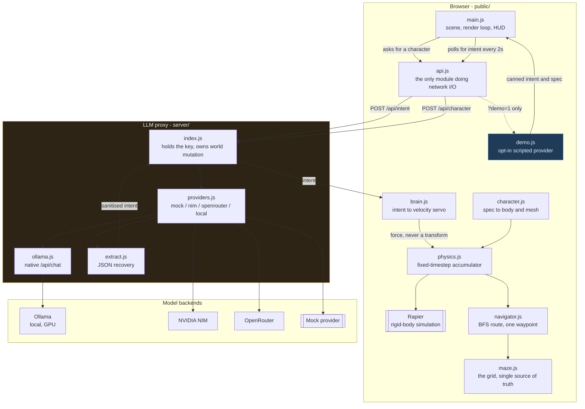
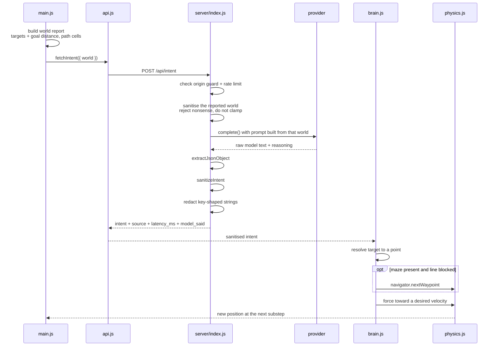
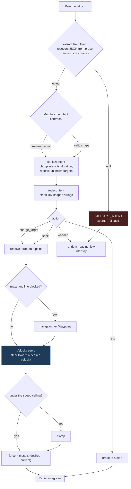
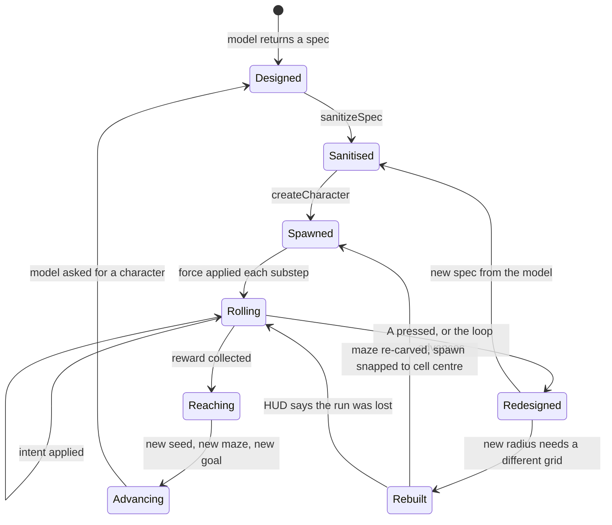

# Architecture

How the system is put together and why. The README covers what the project is;
this covers how it works and what forced each decision.

- [The constraint that dictates everything](#the-constraint-that-dictates-everything)
- [System architecture](#system-architecture)
- [Request flow](#request-flow)
- [The AI decision pipeline](#the-ai-decision-pipeline)
- [Character lifecycle](#character-lifecycle)
- [Who navigates](#who-navigates)
- [The loop](#the-loop)
- [Bounds that keep a bad model from breaking the simulation](#bounds-that-keep-a-bad-model-from-breaking-the-simulation)
- [The control rule](#the-control-rule)
- [The contracts](#the-contracts)
- [Layout](#layout)

---

## The constraint that dictates everything

An LLM call takes **300ms - 2s** at best. A frame takes **16ms**. An LLM can
therefore never drive per-frame motion. Any design where the model sets the
character's velocity each step is dead on arrival.

The model is an **intent layer above a deterministic physics engine**:

```
LLM  (slow)  ->  intent: "seek the ramp", "wander", "rest"
Physics (fast) owns all motion, collisions and forces
```

`brain.js` turns intent into a force. Rapier owns everything else. It never sets
a velocity or a position.

**Two clocks, deliberately:**

- intents are held for `duration_s` of *simulation* time, so a backgrounded tab
  does not change the character's mind;
- requests are paced from *wall-clock completion*, so a slow provider makes the
  brain ask less often instead of stacking up requests.

---

## System architecture



The browser never holds a credential. `api.js` is the only module that performs
network I/O, and it can only reach two endpoints.

---

## Request flow

One intent cycle, from the page's world report to a force on the body.



Three things worth noting in that sequence:

1. **The world travels with the request.** The server cannot know whether a maze
   exists, so the page reports it on every call and the prompt is built from
   that. A prompt frozen at module load is how a model ends up steering at
   something that is not there.
2. **Nonsense is rejected, not clamped.** A negative `path_cells` clamped to 0
   would tell the model "you are at the goal". A confident lie is worse than an
   admitted unknown.
3. **It is sanitised three times** — proxy, client, brain. A response is trusted
   no more than a model is.

---

## The AI decision pipeline

What happens to one model answer on its way to becoming movement.



The two paths that matter most are the ones that look like successes:

- **`Fallback`** is a valid intent. It is indistinguishable from a model that
  chose to wander, except that `source` says otherwise.
- **`sanitizeIntent` clamping** is also a valid intent. A model asking for
  `intensity: 5` gets `1`, and nothing anywhere reports that it asked for
  something impossible. The proxy returns a `sanitised` flag for exactly this.

---

## Character lifecycle

From a model-written JSON object to a rolling body, and what replaces it.



Two rules are load-bearing here:

- **The maze is sized from the character radius.** The model picks `radius`
  freely, so a fixed corridor would strand a fat character. Grid dimensions are
  derived from the radius and clamped to 3x3-9x9, so a `radius: 2.0` character
  gets a coarser — but still real — maze rather than one it cannot enter.
- **A new maze and a new character are separate events.** A maze is free and
  instant; a character is a model call worth 14-65s. Awaiting the character
  before advancing would mean watching a finished board for most of a minute.

---

## Who navigates

The maze is the sharpest version of the problem this project exists to solve, so
the split is worth being explicit about.

**The model chooses the goal. Deterministic code chooses the route.** One intent,
`charge_target -> goal`, and the character walks the entire maze on that one
decision.

The alternative — asking the model for "go left, now go right" — is not a
trade-off, it is impossible here. A 37-second-latency model cannot supervise a
turn, and a 1.5B model cannot hold a maze in its head. Putting reasoning in the
model would also mean the character only works when the model is fast and clever,
which is exactly the coupling this architecture exists to avoid.

So navigation is local and boring, and it is **testable in a way the rest of the
system cannot be**: 12 seeds x 4 character sizes, all solved, no model involved.

Three pieces, each with one job:

- **`maze.js`** — a grid, carved by recursive backtracker from a seed. The grid is
  the *only* source of truth; collision geometry and the navigation graph are
  both derived from it. Defining the maze twice is the obvious way to build this
  and the wrong one — the two disagree the first time a wall moves, and the
  failure is a character that confidently walks into a wall.
- **`navigator.js`** — BFS for the route, then one waypoint at a time. Stateless
  on purpose: an earlier version cached the route and advanced an index, and when
  the target moved the route thrashed.
- **`brain.js`** — a velocity servo, not a position controller. This is what
  makes corners survivable; see [debugging-lessons.md](debugging-lessons.md).

---

## The loop

A collected reward ends the run and the next one starts immediately: new seed,
new maze, new goal, new character.

The brain is also `poke()`d on the advance, because the goal it was told about no
longer exists; without that it steers at the old goal's coordinates until the
intent lapsed.

Verified unaided by a real local model (`qwen3:4b`), with no manual steering:

```
t=  65.05  REWARD  maze 5x5, path 13 cells
t=  65.05  ADVANCE seed 2 5x5
t= 203.27  NEW CHARACTER  Sparkle r=0.25
t= 208.73  REWARD  maze 5x5, path 11 cells
t= 208.73  ADVANCE seed 3 5x5
t= 297.77  NEW CHARACTER  Sproing r=0.25
t= 308.02  REWARD  maze 5x5, path 9 cells
t= 308.02  ADVANCE seed 4 5x5
```

---

## Bounds that keep a bad model from breaking the simulation

A model is untrusted input. Every response is sanitised three times — proxy,
client, brain — and the bounds are what make a bad answer harmless:

| Field | Bound | Why |
| --- | --- | --- |
| `restitution` | 0 – **0.95** | at 1.0 the solver injects energy and the character accelerates forever |
| `intensity` | 0 – 1 | multiplies an acceleration ceiling; above 1 is how a model talks a character through a wall |
| `radius` | 0.15 – 2.0 | larger still fits the arena |
| `duration_s` | 0.5 – 10s | stops a single intent dominating |

Plus a **speed ceiling** (10 m/s, and 3.5 m/s while navigating — corners are the
binding constraint, not tunnelling) and a **substep cap** in the fixed-timestep
loop. A hostile-intent test — intensity `999`, duration `1e9`, a rotating cast of
actions, 60 seconds — stays inside the arena and under the ceiling.

---

## The control rule

**The model must never emit transforms, velocities or positions.** Intent only;
deterministic code applies forces.

`rest` is verified to *brake* — bring the character to under 0.2 m/s within 5s,
where an identical unsteered world is still coasting. It is deliberately **not**
bit-for-bit identical to applying no force, which an earlier version was. Since
steering became a velocity servo, "rest" means "come to a stop" rather than
"stop issuing thrust", and a character told to rest should actually stop.

---

## The contracts

### Character spec — model to client

```json
{
  "name": "Bounce-7",
  "radius": 0.6,
  "color": "#e05a3f",
  "mass": 1.2,
  "restitution": 0.85,
  "roughness": 0.35,
  "personality": "reckless, favours chaos over efficiency"
}
```

Radius / mass / restitution / roughness drive the Rapier body and the three.js
material. `name` and `personality` are metadata — `personality` is the hook for
the control layer's prompt.

**All fields are untrusted.** Numeric strings are accepted (`"0.6"` → `0.6`);
empty strings are rejected explicitly, because `Number('')` is `0`. Colours are
strictly 3- or 6-digit hex. `NaN` and `±Infinity` fall back per-field.

### Intent — model to client

```json
{ "action": "seek" | "wander" | "charge_target" | "rest",
  "target": "block_a" | "block_b" | "ramp" | "goal",
  "intensity": 0.6, "duration_s": 3.0 }
```

`action` is a **closed enum**; anything else becomes `wander`. The arena target
ids come from `public/targets.js` — the same file the physics world builds its
obstacles from. `goal` is added by the *page*, which knows whether a maze exists.
Unknown ids degrade to a wander.

`target` is a free string in the schema, deliberately — an enum of ids would go
stale the moment the world changes. But it **is** `required`, and that is a
separate decision with a measured reason: an optional target is an escape hatch
that small models take every time, and a null target silently means the character
does nothing. See [debugging-lessons.md](debugging-lessons.md).

`target: null` is still reachable at *runtime* — `sanitizeIntent` produces it for
any response without a usable string, and it is the internal fallback. It is only
the model's output space that no longer offers it.

---

## Layout

```
bounce/
  server/
    index.js       the proxy — holds the key, owns all world mutation
    providers.js   mock / ollama / nim / openrouter adapters
    ollama.js      Ollama native /api/chat — the only place `think` is honoured
    errors.js      ProviderError, shared without an import cycle
    extract.js     JSON recovery from messy model output
  public/
    spec.js        character limits + sanitiser      (shared with server)
    intent.js      intent limits + sanitiser         (shared with server)
    schema.js      JSON Schema derived from the above — constrained decoding
    targets.js     the aimable obstacles — one source of truth
    maze.js        the grid: carved once, collision + routing both derived
    navigator.js   BFS route, then one waypoint at a time
    character.js   spec -> Rapier body + three.js mesh
    physics.js     world, maze or arena, fixed-timestep accumulator
    brain.js       the slow brain: intent -> velocity servo
    api.js         the only module that does network I/O
    demo.js        opt-in in-page provider, for static hosting with no backend
    main.js        scene, render loop, goal marker, HUD
  test/            16 suites, 291 assertions (+ 142 browser)
  scripts/         env-wiring, benchmarks, latency, live checks,
                   maze timing/diagnosis, substep budget, loop check,
                   demo-mode check, reseed check, goal-prompt check,
                   wall penetration
docs/              this file, plus screenshots
```

**Why the shared modules live under `public/`:** the static server's document
root is `public/`, so the browser has to be able to import them — and the server
enforces the *same* rules rather than keeping a second copy that could drift.
